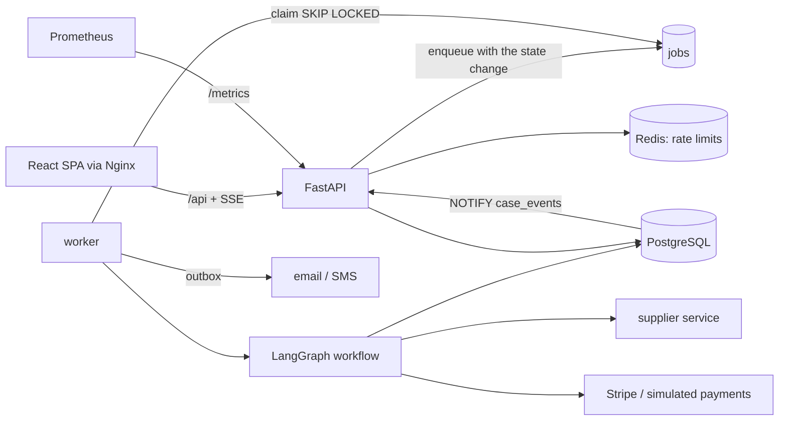

# CareTrip Ops V5.0 — Agentic Travel Service Platform for Seniors

**ZEIL Hackathon 2026 — Project** · New Zealand scope · Synthetic supply, simulated or Stripe test payments

**Demo video:** [Watch the CareTrip Ops walkthrough on YouTube](https://youtu.be/jF3KvJW-WAQ) (recorded on V4.0; see
[`CHANGELOG.md`](CHANGELOG.md) for everything added since)

## Project overview

CareTrip is an **Agentic Travel Service Platform for Seniors**. Older travelers, and the family members who help them,
describe a trip in plain words; CareTrip clarifies what is missing, finds offers, checks each accessibility claim
against independent evidence, ranks the offers with reasons, and books only after the traveler approves the exact
price. The journey is request → clarification → supplier discovery → evidence check → ranking → traveler approval →
payment → booking → cancellation, with a case-bound travel guide and trip companion around it.

Travelers sign in with an emailed (or texted) code and can share a trip with family as viewers or co-planners; only the
traveler approves, pays and cancels. Supplier offers and accessibility evidence come from a **synthetic supplier
simulator** behind a real supplier interface, for all six destinations. Payments are **simulated** unless Stripe test
keys are configured, in which case Stripe Checkout holds the card and captures only after the supplier confirms.

## Key features

- Accounts with email or SMS codes, family roles (viewer, co-planner, hand-over to the traveler), step-up confirmation
  before paying, cancelling or deleting, terms consent, data export and account deletion.
- A consented needs profile (wheelchair, walking limit, step-free access, accessible bathroom, diet, medical notes,
  emergency contact) that decides which access claims every offer must prove. Medical notes never reach a model.
- A LangGraph workflow in a separate worker: PostgreSQL checkpoints, a job queue with one run per trip, human
  interrupts for clarification, advisor review, approval and payment, and explicit recovery.
- Per-claim evidence (lift, step-free entry, accessible bathroom) with source URLs and content hashes; contradicted
  claims are blocked, unproven ones become one advisor review each.
- Ranking on accessibility, price, walking pace, cancellation flexibility, rating and meals, with the reason behind
  each.
- Authorize-then-capture payments, an order lifecycle with cancellation and refunds by the offer's own policy, and an
  email outbox that reaches everyone on the trip.
- Trip companion: departure reminders, a large-print printable trip card, and a Help button that shows 111 and alerts
  family and advisors.
- Advisor console for help requests, evidence reviews and every trip (read-only), with audited access to needs.
- Travel guide by text or optional Gemini Live voice; answers cite official place pages and evidence records; the
  outline can be rewritten by the traveler or revised by a Planner/Reviewer model pair.
- English by default with Simplified Chinese throughout, larger-text mode, 44px targets, WCAG 2.1 AA checked with axe.

## Hackathon demo scope

**One core demonstration:** a traveler signs in, plans the sample Auckland trip (three travelers, three days, NZD 1000,
a lift), sees offer A blocked on contradicted evidence, C unsettled and B verified, approves B, and gets a booking
reference, a trip card and a refund quote, while family members follow live. **Supporting experiences:** a saved needs
profile that changes which claims are checked; an NZD 900 budget that sends C's unproven claims to the advisor console;
the Help button; the guide with cited answers; and the same flows in Chinese. Every destination has synthetic packages.
Live model and voice paths are optional and were not re-verified against real providers in this iteration.

## System architecture



Compose runs `db`, `redis`, `migrate` (applies migrations once, then exits), `api`, `worker`, `supplier` (the
simulator), `stripe-mock` (tests only) and `web` (Nginx on port 8080); `e2e` (Playwright) runs only with
`--profile e2e`. A partial unique index allows one queued or running job per trip; workers heartbeat, and a reaper
marks a trip `RECOVERY_REQUIRED` when its worker disappeared. No database lock is held across a supplier or payment
call, and every external write carries an idempotency key derived from our own IDs.

| Path | Contents |
|---|---|
| `backend/app/api/` | Routers: `accounts`, `phone`, `privacy`, `cases`, `bookings`, `companion`, `advisor`, `guide`, `voice` |
| `backend/app/workflow/`, `graph.py` | LangGraph nodes (`planning`, `offers`, `checkout`) and their wiring |
| `backend/app/models/`, `db.py` | SQLAlchemy models by domain; `db.py` re-exports them with shared helpers |
| `backend/app/booking.py`, `payments.py`, `suppliers.py` | Order lifecycle, payments, supplier client |
| `backend/app/auth.py`, `members.py`, `privacy.py` | Codes, sessions, step-up and roles; family sharing; export and deletion |
| `backend/app/guide.py`, `guide_text.py`, `two_brains.py` | Travel guide, its replies, the Planner/Reviewer pair |
| `backend/app/companion.py`, `advisors.py`, `reviews.py` | Reminders, trip card, help; advisor console and reviews |
| `backend/app/skills/` | Typed skills (see `SKILLS.md`) |
| `backend/supplier_sim/` | The supplier simulator and its catalog |
| `frontend/src/` | `components/` (with `guide/`, `dashboard/`, `phone/`), `hooks/`, `locales/zh.ts`, `legal.ts` |
| `e2e/`, `scripts/` | Playwright journeys; backup and restore |

## Agent workflow and Skills

The workflow is a constrained LangGraph state machine. The **Requirements** node extracts and validates the request
(deterministic parser, or Gemini/OpenAI in API mode) and pauses for clarification at most twice. The **Travel
Planner** writes an illustrative outline; in API mode a separate **Travel Reviewer** call critiques it and the Planner
revises once if needed. **Discovery** fetches supplier offers with their evidence; **Comparison** ranks them;
**Evidence** reads the per-claim verdicts; the **Manager** reranks once or hands unproven claims to an advisor and
pauses until they are settled. **Approval**, **Payment** and **Booking** then hold, authorize, book and capture;
**Review** closes the trip. Money and evidence decisions are deterministic: models only extract requirements and write
illustrative text, under a per-trip call budget, and their output is schema-validated and screened for unverified
prices, durations, distances and booking claims.

Skills are typed Python functions the nodes call: `extract_requirements`, `validate_requirements`, `search_suppliers`,
`required_claims`, `compare_offers`, `verify_evidence` / `assess_offer`, `rerank_offers`, `refund_percent`,
`prepare_approval` and `generate_review`. Contracts, rules and tests are listed in
[`backend/app/skills/SKILLS.md`](backend/app/skills/SKILLS.md). Approval is committed before the graph resumes, and a
unique booking key prevents a second order on replay.

The guide reads the same trip. Text answers follow explicit rules (place, next stop, access, revision, package
change); voice uses a server-side Gemini Live bridge with a read-only `get_current_trip` tool. Revisions are proposals
the traveler accepts or keeps; neither they nor traveler edits change an offer, approval or order.

## Tech stack

React 19, TypeScript, Vite, Python 3.12, FastAPI, Pydantic v2, LangGraph, LangChain, Google Gen AI SDK, SQLAlchemy,
Alembic, PostgreSQL 16, Redis 7, Stripe, Nginx, Docker Compose, Pytest, Playwright with axe-core, GitHub Actions and
Prometheus.

## Getting started

### Prerequisites

- Docker Desktop with Compose (the PostgreSQL service uses a named volume).
- For non-container development: Python 3.12, PostgreSQL 16, Redis (optional), Node.js 22 and npm.

### Environment setup

Copy `.env.example` to `.env` and keep it local; it is ignored by git. The defaults run everything offline:
`MODEL_MODE=mock_llm`, console email and SMS (codes appear on the page and in the API log), simulated payments and the
bundled supplier simulator.

- **Advisor console:** set `ADVISOR_EMAILS=you@example.com`, restart, and sign in with that address.
- **Stripe test mode:** set `PAYMENT_PROVIDER=stripe` and `STRIPE_SECRET_KEY=sk_test_...`; forward webhooks with
  `stripe listen --forward-to localhost:8080/api/payments/stripe/webhook` and copy the `whsec_...` value into
  `STRIPE_WEBHOOK_SECRET`; check with `docker compose exec api python -m app.payments`; pay with `4242 4242 4242 4242`.
- **Live models:** `MODEL_MODE=api` with `LLM_PROVIDER=gemini` and `GEMINI_API_KEY` (or `openai` with
  `OPENAI_API_KEY`); `GEMINI_PLANNING_ENABLED=true` adds the Planner/Reviewer outline. Provider errors never fall back
  to mock output. The Gemini Live voice button appears only when a key is configured.

### Docker start and stop — operator commands

```bash
docker compose up --build -d   # build and start; open http://localhost:8080
docker compose ps
docker compose logs api worker
docker compose down            # stop; keeps the database
```

Do not use `down -v` for a normal shutdown: it deletes the PostgreSQL volume. API documentation is at
http://localhost:8080/api/docs outside production.

### Database migration

The `migrate` service runs `alembic upgrade head` once; `api` and `worker` start only after it succeeds, so several
API replicas never race. Before deploying a new version elsewhere, run `docker compose run --rm migrate`. Without
Docker, set `DATABASE_URL`, then from `backend/` run `alembic upgrade head` and `uvicorn app.main:app --reload` (the
API runs an embedded worker when `EMBEDDED_WORKER=true`). Migrations `0001`–`0013` are explicit and reversible, and CI
checks a full downgrade and upgrade. Workflow node names are stored in checkpoints: add nodes rather than renaming them.

## Environment variables

| Variable | Purpose | Default |
|---|---|---|
| `APP_ENV` | `production` refuses demo secrets, console email or SMS, simulated payments, the in-process supplier or no Redis, and disables `/api/docs` | `development` |
| `DATABASE_URL`, `REDIS_URL` | PostgreSQL connection; shared rate limits across API processes | set by Compose |
| `AUTH_SECRET`, `DEMO_NONCE_SECRET` | Pepper for codes and sessions; approval nonce secret (32+ characters in production) | local values |
| `AUTH_DEV_RETURN_CODE` | Show sign-in codes on the page (development only) | `true` |
| `SESSION_DAYS`, `LOGIN_CODE_MINUTES`, `STEP_UP_MINUTES` | Session and code lifetimes; how recent a confirmation must be for sensitive actions | `30`, `10`, `10` |
| `LOGIN_CODE_LIMIT_PER_EMAIL_PER_HOUR`, `LOGIN_CODE_LIMIT_PER_IP_PER_HOUR` | Sign-in code rate limits | `5`, `30` |
| `CASE_CREATE_LIMIT_PER_IP_PER_HOUR`, `CASE_CREATE_LIMIT_GLOBAL_PER_HOUR` | New trips per hour; with the call budget this caps model spend | `30`, `300` |
| `EMAIL_BACKEND`, `EMAIL_FROM`, `SMTP_*` | `console` or `smtp` | `console` |
| `SMS_BACKEND`, `TWILIO_ACCOUNT_SID`, `TWILIO_AUTH_TOKEN`, `TWILIO_FROM` | Text-message codes: `off`, `console` or `twilio` | `console` |
| `SUPPLIER_BASE_URL`, `SUPPLIER_API_KEY` | Supplier endpoint; empty runs the simulator in-process | Compose: `http://supplier:9000` |
| `PAYMENT_PROVIDER`, `STRIPE_SECRET_KEY`, `STRIPE_WEBHOOK_SECRET` | `simulated` or `stripe` | `simulated` |
| `ADVISOR_EMAILS`, `SUPPORT_PHONE` | Advisor accounts; a support number for trip cards and Help | empty |
| `METRICS_TOKEN` | Bearer token for `/metrics` | empty |
| `MODEL_MODE`, `LLM_PROVIDER`, `GEMINI_*`, `OPENAI_API_KEY`, `MODEL_NAME` | Optional live models | `mock_llm` |
| `MAX_LLM_CALLS_PER_CASE`, `MAX_RERANKS`, `MAX_CLARIFICATIONS`, `MAX_LIVE_SESSIONS_PER_CASE` | Workflow bounds | `7`, `1`, `2`, `2` |
| `EMBEDDED_WORKER`, `WORKER_CONCURRENCY`, `TRUST_PROXY` | Worker placement and tuning; trust Nginx's client IP | Compose: `false`, `4`, `true` |
| `LOG_FORMAT`, `LOG_LEVEL`, `SENTRY_DSN` | Logging and optional Sentry | `json`, `INFO` |
| `FRONTEND_ORIGIN` | Public site origin (Checkout return URLs, voice origin check) | `http://localhost:8080` |

Keep `.env` local and never commit keys.

## Application pages

- `/` — homepage with trip intake, six destinations (each with synthetic packages), travel styles and the companion.
- `/mobile` — the traveler view in a phone frame: Explore, My Trips (trips and family invitations), the trip itself
  with approval, payment, booking and cancellation, AI Guide, and Help with 111 and the help request.
- `/dashboard` — operations view: requirements and saved needs, offers, per-claim verification, the execution path
  and the audit trail.
- `/demo` — dashboard and phone side by side on the same trip.
- `/trip-card` — large-print, printable trip card.
- `/account` — name, mobile number for text codes, travel needs (with consent), data download and account deletion.
- `/advisor` — advisor console (advisors only).
- `/terms`, `/privacy` — Terms of Use and Privacy Notice in English and Chinese.

## API documentation

Responses are `{ "data": ..., "request_id": "..." }` or `{ "error": { "code", "message", "retryable" }, "request_id" }`;
money is a string and every response carries `X-Request-ID`.

- Auth: `POST /api/auth/request-code`, `/verify` (email or phone), `/logout`; `GET`/`PATCH /api/auth/me`;
  `POST /api/auth/step-up/request`, `/step-up/verify`; `PUT`/`DELETE /api/auth/me/phone`, `POST
  /api/auth/me/phone/verify`
- Privacy: `PUT /api/auth/me/consent`, `GET`/`PUT /api/profile`, `GET /api/auth/me/export`, `DELETE /api/auth/me`
- Trips: `GET`/`POST /api/cases`; `GET /api/cases/{id}`, `/offers`, `/evidence`, `/approvals`, `/orders`, `/events`,
  `/snapshot` (all in one read), `/stream` (server-sent events), `/trip-card`; `POST /clarifications`, `/resume`,
  `/approvals/{id}/decision`, `/help`; `PUT /itinerary`
- Payments and orders: `POST /api/cases/{id}/payments/sync`, `/orders/{orderId}/cancel`; `POST
  /api/payments/stripe/webhook`
- Family: `GET /api/cases/{id}/members`, `POST /invitations`, `DELETE /invitations/{id}`, `DELETE /members/{userId}`;
  `GET /api/invitations`, `POST /api/invitations/{id}`
- Advisors: `GET /api/advisor/reviews`, `/help`, `/cases`, `/cases/{id}/traveler`, `/cases/{id}/notes`;
  `POST /api/advisor/reviews/{id}`, `/help/{id}`, `/cases/{id}/notes`
- Guide: `GET /api/guide/capabilities`, `GET /api/cases/{id}/guide`, `POST /guide/attraction`, `/guide/messages`,
  `/guide/revisions`, `/guide/revisions/decision`; `WS /api/cases/{id}/guide/live`
- Operations: `/healthz`, `/readyz`, `/metrics` (internal network only)

Reads need trip membership (or an advisor reading); planning needs `CO_PLANNER`; approving, paying, cancelling and
managing members need `OWNER`. Non-members get `404`, and cross-site writes are rejected.

## Demo walkthrough

1. Start the stack and open http://localhost:8080/demo. Sign in with any email; the code is shown on the page in
   development. Accept the terms on first sign-in.
2. Use the Auckland example (three travelers, three days, NZD 1000, a lift). The dashboard shows A blocked on
   contradicted evidence, C unsettled and B verified, each claim with its sources, and the ranking reasons.
3. In the phone view choose *Review and approve*, then approve B. The simulated payment authorizes, the supplier
   books, and the booking reference, refund quote and large-print trip card appear. Cancelling shows the refund first.
4. Invite a family member as a viewer from the trip; they follow the same trip live after signing in.
5. On `/account`, give consent and save a manual wheelchair. A new trip now also checks accessible bathrooms.
6. Set `ADVISOR_EMAILS` and plan with a budget of NZD 900: C's unproven claims appear in `/advisor`; passing them
   resumes the trip to approval. A Help request from the phone also appears there.
7. Ask the guide "Is my stay step-free?" to see an answer with its evidence, and switch to 中文 at the top right.

## Testing

```bash
docker compose exec api pytest -q        # backend, on its own caretrip_test database
docker compose exec api alembic check     # models and migrations agree
docker compose --profile e2e run --rm e2e # browser journeys and axe checks against the running stack
```

Frontend (Node 22): `npm run build` and `node --experimental-strip-types --test tests/*.test.mjs` in `frontend/`. The
advisor journey in `e2e` runs when `ADVISOR_EMAILS` (API) and `E2E_ADVISOR_EMAIL` (e2e) name the same address; raise
`LOGIN_CODE_LIMIT_PER_IP_PER_HOUR` for repeated local runs, since every browser test signs in from one address.

Current results: 187 backend tests, 15 frontend tests (including a check that every UI string has Chinese) and 21
browser tests (desktop and phone, axe WCAG 2.1 AA in English and Chinese) pass locally. Backend tests are hermetic:
the simulator runs in-process, payments are simulated or faked, the Stripe client is contract-tested against
`stripe-mock` and the shared limiter against Redis. `.github/workflows/ci.yml` runs migrations up and down,
`alembic check`, all three suites, the image builds and `nginx -t`; all three jobs passed on GitHub for the first
pull request and its merge into `main`.

## Operations

- **Backups.** `scripts/backup.sh` writes a compressed `pg_dump` to `backups/` and keeps the newest 14;
  `scripts/restore.sh --check <dump>` restores into a scratch database, compares row counts and drops it. Copy dumps
  off the machine; they contain health details.
- **Metrics.** Prometheus scrapes `api:8000/metrics`: requests and latency per route, runs by status and the oldest
  queued run, unsent emails, trips and orders by status, open reviews and unanswered help requests.
- **Logs.** JSON lines with `request_id`, `user_id` and `case_id`; optional Sentry.
- **Proxy.** Nginx re-resolves the API through Docker's DNS, so recreating the API never needs a web restart.

## Current limitations

Suppliers, offers and accessibility evidence are synthetic; a real supplier needs a partner account and a
`SupplierProvider` implementation, and real evidence needs a source and review process. Stripe has been exercised only
against `stripe-mock` and the self-check, and Twilio only in console mode. Gemini requirements, the Planner/Reviewer
pair and Gemini Live voice were not called against real providers in this iteration; their tests use fakes. The terms
and privacy notice are templates that a New Zealand lawyer must review and complete. Medical notes are stored
unencrypted and advisor access relies on an email allow-list without 2FA, which is not sufficient for real health data.
The traveler view is a phone frame inside a web page, not a native app or PWA. Guide intents use keyword rules, and
illustrative outlines can still contain model mistakes; only the offer path is evidence-gated. A handover whose new
traveler has different needs after offers were checked goes to a person rather than re-planning automatically.

## Bonus challenge evidence

- **Break It, Fix It:** the supplier simulator injects outages, rejections, price changes, sold-out dates and expired
  holds; tests show outages retried with backoff, price changes failing the order and releasing the card hold, lapsed
  holds renewed at the approved price, and a refused cancellation restoring the booking. Browser tests found and fixed
  real UI defects (see `CHANGELOG.md`).
- **Grounded:** guide answers cite official newzealand.com pages for places and the supplier evidence records for
  access claims; the evidence itself is synthetic.
- **Planner/Reviewer collaboration and Strict Shapes:** model output is parsed into Pydantic schemas and rejected when
  it breaks day counts, allowed places or the unverified-claim rules; unit tests drive the two-call loop, the revision
  mode and the budget fallback with fake clients. Real provider evidence was not collected in this iteration.
- **Live voice and function calling:** the server-side Gemini Live bridge and its read-only `get_current_trip` tool are
  implemented but untested with the real provider, so eligibility is not claimed.
- The opt-in evaluation harness (`backend/evals/itinerary_eval.py`, ten New Zealand cases) has not been run against
  real models in this iteration.

## What you didn't write

Iterations up to V4.0 used OpenAI Codex as a coding assistant; V5.0 was developed with Anthropic's Claude Code as a
coding assistant. React, Vite, FastAPI, LangGraph, LangChain, SQLAlchemy, Alembic, PostgreSQL, Redis, Nginx,
Playwright, axe-core, the Stripe and Google Gen AI SDKs and their dependencies are third-party software. Destination
photographs come from Wikimedia Commons under the licenses recorded in `docs/DESTINATION_IMAGE_TRACEABILITY.md`. The
V3.2 review package and reference images supplied by the project owner guided the product design. The maintainer
should add any other tools or external contributions before submission.

## Future roadmap

- Real accessible supply: partner suppliers, a source and review process for evidence, and a model step that turns
  reviews, photos and audits into cited claims with human review.
- Health-data protection for launch: field-level encryption, encrypted backups, advisor 2FA and finer roles, and a
  separate staff console from the consumer app.
- A real mobile experience (PWA, later native) designed around the adult child who plans for a parent.
- Transport and transfers, travel insurance, and an access guarantee policy with liability cover.
- Model-based guide intents with evaluation sets in CI, prompt and cost tracing, a fallback provider, and verified
  Gemini Live voice.
- Generated TypeScript types from the OpenAPI schema, product analytics for the booking funnel, and staging with
  zero-downtime deploys.

The project design derives from the historical CareTrip Ops proposal and the V3.2 review package under
`CareTrip_Final_Review_Package/`.
