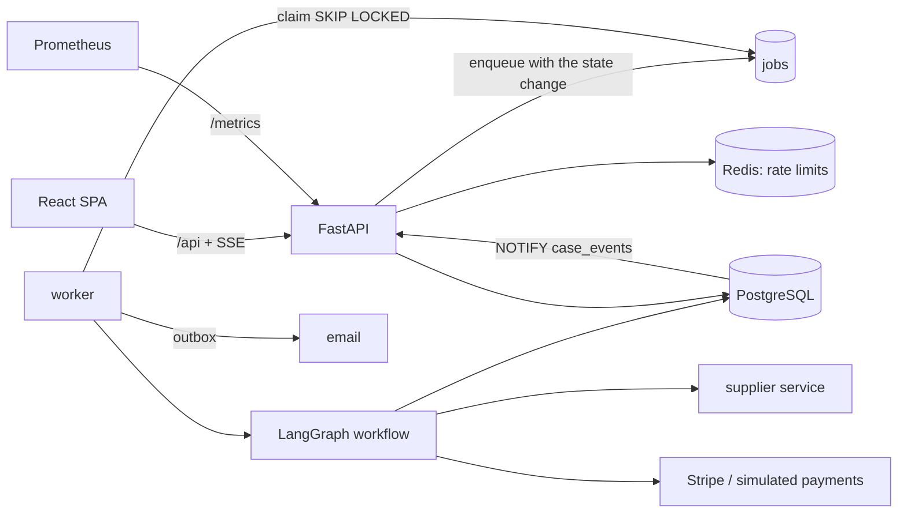

# CareTrip Ops — Agentic Travel Service Platform for Seniors

**ZEIL Hackathon 2026 — Project** · New Zealand scope · **Demo video:** [CareTrip Ops walkthrough on YouTube](https://youtu.be/jF3KvJW-WAQ)

CareTrip helps older travelers plan, verify and book trips, with family able to follow or help. The journey is
request → clarification → supplier offers → evidence check → ranking → traveler approval → payment → booking →
cancellation, plus a case-bound travel guide. The supplier is a **simulator** behind a real supplier interface, and
payments are **simulated** unless Stripe keys are configured. All offers and accessibility evidence are synthetic.

## What it does

- **Accounts and family.** Sign-in with a 6-digit code by email, or by text message once a mobile number is verified
  (no password); HttpOnly session cookie. Each trip has an owner (the traveler) who can invite family as *viewer* or
  *co-planner*, or **hand the trip over**: a daughter can plan for her mother, who then becomes the traveler and alone
  approves and pays. Only the traveler approves, pays and cancels.
- **Privacy and consent.** Terms and privacy notice (bilingual templates for legal review) accepted at first sign-in and
  again when the version changes. Paying, cancelling and deleting the account need a code confirmed within 10 minutes
  (step-up). Travelers can download all their data as JSON and delete their account (refused while a booking is
  active; trips are redacted, booking records anonymized).
- **Travel needs.** With separate consent, a traveler saves wheelchair use, walking limit, step-free access, accessible
  bathroom, diet, medical notes and an emergency contact. New trips snapshot these needs (never the medical notes) and
  every needed access claim (lift, step-free entry, accessible bathroom) must be proven per offer; walking limits and
  diet shape the ranking. Withdrawing consent erases the details.
- **Workflow.** A LangGraph workflow with PostgreSQL checkpoints: requirements (deterministic parser or Gemini/OpenAI),
  clarification, an illustrative itinerary (optional Gemini Planner + Reviewer), supplier discovery, evidence
  assessment, ranking, Manager arbitration, approval, payment and booking.
- **Supplier.** `SupplierProvider` interface with an HTTP client (timeouts, retries, circuit breaker, idempotency keys).
  The bundled simulator has packages for all six destinations (some with accessible airport transfers), inventory,
  expiring holds, price changes, rejections and outages (fault injection).
- **Evidence and advisors.** Each access claim of each offer is judged from independent sources (with source URL and
  content hash); the weakest claim decides. Contradicted claims are blocked; inconclusive ones become one review per
  claim in the **advisor console** (`/advisor`), which also lists help requests and every trip (read-only access,
  booking and payment state, the traveler's needs with an audit record of each view, and advisor notes).
- **Ranking.** Offers are scored on accessibility (35%), price (25%), walking pace (15%), cancellation flexibility (15%)
  and rating (10%), plus meals (10%) when the traveler has dietary needs, with the reasons shown to the traveler.
- **Payments and orders.** Stripe Checkout with a manual-capture hold: the card is captured only after the supplier
  confirms, and released on any failure. Orders move PENDING_PAYMENT → CONFIRMED → CANCELLATION_REQUESTED → CANCELLED
  (or FAILED). Refunds follow the cancellation policy stored in the approved offer snapshot.
- **Trip companion.** Reminders to everyone on the trip a week and a day before departure (sent once each), a
  large-print printable trip card, and a Help button that shows 111 and tells the family and advisors at once.
- **Notifications.** An email outbox written in the same transaction as the event; the worker sends it with retries.
- **Live updates.** PostgreSQL `NOTIFY` → server-sent events; the browser re-reads a trip only when it changes.
- **Travel guide.** Text guide with deterministic rules and optional Gemini Live voice. Answers cite their sources:
  the official page for a place, and the evidence records when asked about access at the chosen stay (it only repeats
  verified claims). Travelers can rewrite the outline themselves or review guide-prepared drafts; neither changes an
  offer, approval or order.
- **For seniors.** English by default with a one-tap switch to Simplified Chinese (UI, guide replies, generated outlines,
  emails; the choice is remembered), larger-text mode, 44px targets, WCAG 2.1 AA checked with axe in both languages.

## Architecture



Compose services: `db`, `redis`, `api`, `worker`, `supplier` (simulator), `stripe-mock` (tests only), `web` (Nginx on
port 8080), and `e2e` (Playwright, only with `--profile e2e`).
A partial unique index allows one queued or running job per trip. Workers heartbeat; a reaper fails runs whose worker
disappeared and marks the trip `RECOVERY_REQUIRED` for an explicit resume. Supplier outages are retried with backoff.
No database lock is held across a supplier or payment call; every external write carries a key derived from our IDs.

### Code map

| Path | Contents |
|---|---|
| `backend/app/main.py` | App assembly: lifespan, middleware, error handling, `/metrics` |
| `backend/app/api/` | Routers: `accounts`, `phone`, `privacy` (step-up, profile, export, deletion), `cases`, `bookings`, `companion`, `advisor`, `guide`, `voice` |
| `backend/app/models/`, `database.py`, `db.py` | SQLAlchemy models by domain; `db.py` re-exports them with shared helpers |
| `backend/app/workflow/` | LangGraph nodes: `planning`, `offers`, `checkout`; `app/graph.py` wires them |
| `backend/app/booking.py`, `payments.py`, `suppliers.py` | Order lifecycle, Stripe/simulated payments, supplier client |
| `backend/app/auth.py`, `members.py`, `privacy.py`, `sms.py` | Codes, sessions, step-up and roles; family sharing and handover; export and deletion; text messages |
| `backend/app/reviews.py`, `advisors.py`, `companion.py` | Advisor reviews, the advisor console, reminders, trip card and help |
| `backend/app/clarification.py`, `guide.py`, `case_state.py` | Missing details, travel guide with citations, itinerary versions and edits |
| `backend/app/jobs.py`, `worker.py`, `events.py`, `notify.py`, `ratelimit.py`, `metrics.py` | Job queue, worker, live updates, email outbox, rate limits, Prometheus |
| `backend/app/skills/` | Typed skills (see `SKILLS.md`) |
| `backend/supplier_sim/` | The supplier simulator and its catalog |
| `frontend/src/hooks/` | Session, live trip snapshot, trip list, step-up confirmation |
| `frontend/src/components/` | Pages and panels; `guide/`, `dashboard/`, `phone/` hold their parts |
| `frontend/src/locales/zh.ts`, `legal.ts` | Chinese text (`tests/i18n.test.mjs` checks every UI string); terms and privacy templates |
| `e2e/` | Playwright journeys and axe checks, run in the Playwright container |
| `scripts/backup.sh`, `scripts/restore.sh` | Database backup and verified restore |

## Getting started

Requires Docker Desktop. From the project root:

```bash
cp .env.example .env
docker compose up --build -d
```

Open http://localhost:8080, sign in with any email (in development the code is shown on the page and printed in the
API log), and plan the sample Auckland trip. API docs: http://localhost:8080/api/docs (disabled in production).
`docker compose down` stops everything; `down -v` also deletes the database volume.

To try the advisor console, set `ADVISOR_EMAILS=you@example.com` in `.env`, restart, and sign in with that address.
To sign in by text, add a mobile number on the Account page; in development the code is shown on the page.

### Using real Stripe test keys

1. In the Stripe dashboard (test mode) copy the secret key, then set in `.env`:
   `PAYMENT_PROVIDER=stripe` and `STRIPE_SECRET_KEY=sk_test_...`.
2. Forward webhooks with the Stripe CLI and copy the `whsec_...` it prints into `STRIPE_WEBHOOK_SECRET`:
   `stripe listen --forward-to localhost:8080/api/payments/stripe/webhook`
3. `docker compose up -d`, then check the configuration: `docker compose exec api python -m app.payments`
4. Book a trip, choose *Pay securely with Stripe*, and pay with the test card `4242 4242 4242 4242`. The card is held,
   then captured once the supplier confirms; cancelling refunds according to the offer's policy.

Returning from Checkout triggers a payment check even without the webhook, but production requires it.

### Live models (optional)

`MODEL_MODE=api` with `LLM_PROVIDER=gemini` and `GEMINI_API_KEY` (or `openai` with `OPENAI_API_KEY`) enables model
requirement extraction; `GEMINI_PLANNING_ENABLED=true` adds the Planner/Reviewer itinerary. Provider errors never fall
back to mock output, and each trip allows at most `MAX_LLM_CALLS_PER_CASE` calls. Gemini Live voice appears only when a
key is configured; it has not been tested against the real provider.

## Configuration

| Variable | Purpose | Default |
|---|---|---|
| `APP_ENV` | `production` refuses to start with demo secrets, console email or SMS, simulated payments, the in-process supplier or no Redis, and disables `/api/docs` | `development` |
| `DATABASE_URL` | PostgreSQL connection | set by Compose |
| `REDIS_URL` | Shared rate limits across API processes (per process when empty) | Compose: `redis://redis:6379/0` |
| `AUTH_SECRET`, `DEMO_NONCE_SECRET` | Hash pepper for codes/sessions; approval nonce secret (32+ chars in production) | local values |
| `AUTH_DEV_RETURN_CODE` | Show sign-in codes on the page (development only) | `true` |
| `SESSION_DAYS`, `LOGIN_CODE_MINUTES`, `STEP_UP_MINUTES` | Session and code lifetimes; how recent a confirmation must be for paying, cancelling and deleting | `30`, `10`, `10` |
| `LOGIN_CODE_LIMIT_PER_EMAIL_PER_HOUR`, `LOGIN_CODE_LIMIT_PER_IP_PER_HOUR` | Sign-in code rate limits | `5`, `30` |
| `CASE_CREATE_LIMIT_PER_IP_PER_HOUR`, `CASE_CREATE_LIMIT_GLOBAL_PER_HOUR` | New trips per hour; with the per-trip model call limit this caps model spend | `30`, `300` |
| `EMAIL_BACKEND`, `EMAIL_FROM`, `SMTP_*` | `console` (development) or `smtp` | `console` |
| `SMS_BACKEND`, `TWILIO_ACCOUNT_SID`, `TWILIO_AUTH_TOKEN`, `TWILIO_FROM` | Text-message codes: `off`, `console` (development) or `twilio` | `console` |
| `SUPPLIER_BASE_URL`, `SUPPLIER_API_KEY` | Supplier endpoint; empty runs the simulator in-process | Compose: `http://supplier:9000` |
| `PAYMENT_PROVIDER`, `STRIPE_SECRET_KEY`, `STRIPE_WEBHOOK_SECRET` | `simulated` or `stripe` | `simulated` |
| `ADVISOR_EMAILS` | Comma-separated emails of travel advisors | empty |
| `SUPPORT_PHONE` | Shown on trip cards and the Help screen | empty |
| `METRICS_TOKEN` | Bearer token for `/metrics` | empty |
| `EMBEDDED_WORKER`, `WORKER_CONCURRENCY`, `WORKER_POLL_SECONDS` | Run workflows inside the API (single-process dev); worker tuning | `true` (Compose: `false`), `4`, `0.5` |
| `TRUST_PROXY` | Trust Nginx's `X-Real-IP` for rate limits | `true` in Compose |
| `LOG_FORMAT`, `LOG_LEVEL`, `SENTRY_DSN` | `json` or `console` logs; optional Sentry | `json`, `INFO` |
| `MODEL_MODE`, `LLM_PROVIDER`, `GEMINI_*`, `OPENAI_API_KEY`, `MODEL_NAME` | Optional live models (see above) | `mock_llm` |
| `MAX_LLM_CALLS_PER_CASE`, `MAX_RERANKS`, `MAX_CLARIFICATIONS`, `MAX_LIVE_SESSIONS_PER_CASE` | Workflow bounds | `7`, `1`, `2`, `2` |
| `FRONTEND_ORIGIN` | Public site origin (Checkout return URLs, voice origin check) | `http://localhost:8080` |

## Pages and API

Pages: `/` home, `/mobile` traveler view, `/dashboard` operations view, `/demo` both side by side, `/trip-card`
printable trip card (these take `?caseId=`), `/account` details, needs, data and deletion, `/advisor` advisor console,
`/terms` and `/privacy`.

API (all JSON as `{data, request_id}` or `{error: {code, message, retryable}, request_id}`; every response carries
`X-Request-ID`):

- Auth: `POST /api/auth/request-code` and `/verify` (email or phone), `/logout`; `GET`/`PATCH /api/auth/me`;
  `POST /api/auth/step-up/request`, `/step-up/verify`; `PUT`/`DELETE /api/auth/me/phone`, `POST /api/auth/me/phone/verify`
- Privacy: `PUT /api/auth/me/consent`, `GET`/`PUT /api/profile`, `GET /api/auth/me/export`, `DELETE /api/auth/me`
- Trips: `GET`/`POST /api/cases`, `GET /api/cases/{id}`, `/offers`, `/evidence`, `/approvals`, `/orders`, `/events`,
  `GET /stream` (server-sent events), `POST /clarifications`, `/resume`, `/approvals/{id}/decision`,
  `PUT /itinerary`, `GET /trip-card`, `POST /help`
- Payments and orders: `POST /api/cases/{id}/payments/sync`, `POST /api/cases/{id}/orders/{orderId}/cancel`,
  `POST /api/payments/stripe/webhook`
- Family: `GET /api/cases/{id}/members`, `POST /invitations` (`VIEWER`, `CO_PLANNER` or `OWNER` to hand over),
  `DELETE /invitations/{id}`, `DELETE /members/{userId}`; `GET /api/invitations`, `POST /api/invitations/{id}`
- Advisors: `GET /api/advisor/reviews`, `POST /api/advisor/reviews/{id}`, `GET /api/advisor/help`,
  `POST /api/advisor/help/{id}`, `GET /api/advisor/cases`, `GET /api/advisor/cases/{id}/traveler`,
  `GET`/`POST /api/advisor/cases/{id}/notes`
- Guide: `GET /api/cases/{id}/guide`, `POST /guide/attraction`, `/guide/messages`, `/guide/revisions`,
  `/guide/revisions/decision`; `WS /api/cases/{id}/guide/live`
- Operations: `/healthz`, `/readyz`, `/metrics` (internal network only)

Reads need membership (`VIEWER`), or an advisor reading; planning actions `CO_PLANNER`; approve, pay, cancel and manage
members `OWNER`. Non-members get `404`. Cross-site writes are rejected.

## Operations

- **Backups.** `scripts/backup.sh` writes a compressed `pg_dump` to `backups/` and keeps the newest 14.
  `scripts/restore.sh --check <dump>` restores it into a scratch database, compares row counts and drops it;
  `scripts/restore.sh <dump> <new_db>` restores for real, never over the live database. Copy dumps off the machine.
- **Metrics.** Prometheus scrapes `api:8000/metrics`: request counts and latency per route template, workflow runs by
  status and the oldest queued run's age, unsent and failed emails, trips and orders by status, open reviews and
  unanswered help requests. Alert on help requests and queue age first.
- **Logs.** JSON lines with `request_id`, `user_id` and `case_id`; optional Sentry.

## Testing

```bash
docker compose exec api pytest -q        # backend, uses its own caretrip_test database
docker compose exec api alembic check     # models and migrations agree
docker compose --profile e2e run --rm e2e # browser journeys and axe checks against the running stack
```

Frontend (Node 22): `npm run build` and `node --experimental-strip-types --test tests/*.test.mjs` in `frontend/`.
The advisor journey in `e2e` runs when `ADVISOR_EMAILS` (API) and `E2E_ADVISOR_EMAIL` (e2e) name the same address;
raise `LOGIN_CODE_LIMIT_PER_IP_PER_HOUR` for repeated local runs, since every test signs in from one address.

Backend tests are hermetic: the supplier simulator runs in-process and payments are simulated or faked; the Stripe
client is contract-tested against `stripe-mock` and the shared limiter against Redis. Current results: 178 backend
tests, 15 frontend tests (including a check that every UI string has a Chinese translation) and 21 browser tests
(desktop and phone, with WCAG 2.1 AA axe checks of every page in English and Chinese) pass.
`.github/workflows/ci.yml` runs migrations (with a downgrade/upgrade round trip), `alembic check`, all three suites,
the image builds and `nginx -t`.

## Limitations

- The supplier and its accessibility evidence are synthetic. Real suppliers need a partner account and a
  `SupplierProvider` implementation.
- Real Stripe has been verified only against `stripe-mock` and the self-check; a full test-card payment needs your keys.
  Twilio text messages have not been sent for real; console mode was used.
- The terms and privacy notice are templates that a New Zealand lawyer must review and complete before launch.
- A handover keeps the needs the trip was planned with when the new traveler has none saved; if theirs differ after
  offers were checked, the trip goes to a person rather than re-planning automatically.
- Gemini Live voice is untested with the real provider. Illustrative itineraries can still contain model mistakes;
  only the offer path is evidence-gated.

## Credits

React, Vite, FastAPI, LangGraph, SQLAlchemy, Alembic, PostgreSQL, Nginx, Stripe and Google Gen AI SDKs are third-party
software. Destination photos come from Wikimedia Commons (see `docs/DESTINATION_IMAGE_TRACEABILITY.md`). Earlier
iterations used OpenAI Codex; later ones used Claude Code. The design derives from the V3.2 review package in
`CareTrip_Final_Review_Package/`.
